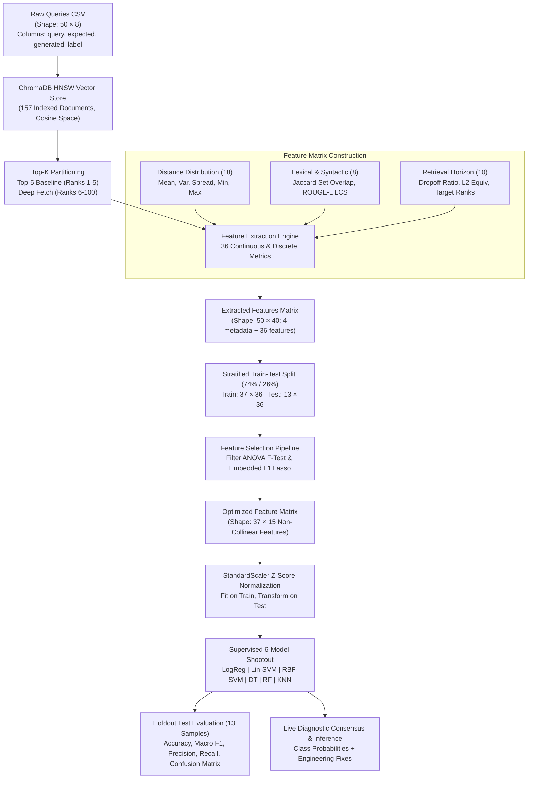

# 🎓 Causal RAG Failure Diagnostician: Comprehensive Academic Master Guide & Viva Defense Manual

**Course:** ML3003 — Machine Learning  
**Project:** Causal RAG Failure Diagnostician Platform  
**Architecture:** Classical Statistical Machine Learning & Dimensionality Reduction (Zero LLM-as-a-Judge)

---

# SECTION 1: Chapter-by-Chapter Syllabus Mapping & Line-by-Line Code Execution

---

## UNIT I: Introduction to Machine Learning

### 1. Types of Learning & Problem Formulation
- **The Concept:** Machine learning systems are categorized by the nature of the learning feedback: Supervised Learning ($(\mathbf{x}_i, y_i)$ pairs with known ground-truth labels), Unsupervised Learning ($\mathbf{x}_i$ without targets, discovering latent data geometry), and Meta-Ensemble Learning (combining multiple predictive hypotheses).
- **File & Function Mapping:** 
  - `modules/data_ingestion.py` $\to$ `validate_rag_dataset()` and `DataQualityReport`
  - `modules/diagnostic_models.py` $\to$ `BaseDiagnosticModel`, `MultiModelDiagnosticSuite`
- **Line-by-Line Code Breakdown:**
  ```python
  # modules/data_ingestion.py
  if "failure_label" in df_work.columns:
      non_null_labels = df_work["failure_label"].dropna()
      if len(non_null_labels) > 0:
          report.has_labels = True
          invalid_category_mask = ~df_work["failure_label"].isna() & ~df_work["failure_label"].isin(FAILURE_CATEGORIES)
  ```
  - `df_work["failure_label"]` contains the discrete target variable $y \in \{0, 1, 2, 3, 4\}$.
  - `FAILURE_CATEGORIES` establishes the 5-class closed-world supervised taxonomy: `Retrieval Miss`, `Ranking Error`, `Context Contamination`, `Hallucination`, `Contradiction`.
  - When `report.has_labels = False`, the system automatically shifts to Unsupervised / Inference mode, routing data through PCA and Apriori rather than supervised loss minimization.
- **Key Execution Drivers:**
  ```python
  from dataclasses import dataclass, field
  from typing import Dict, List, Optional, Tuple, Any
  import pandas as pd
  import numpy as np
  ```

---

### 2. Training, Testing & Stratified Cross-Validation
- **The Concept:** Minimizing Empirical Risk on training data ($\min_{\mathbf{w}} \frac{1}{N}\sum L(y_i, f(\mathbf{x}_i))$) risks overfitting. Generalization performance must be estimated on holdout test data $\mathcal{D}_{\text{test}}$ disjoint from $\mathcal{D}_{\text{train}}$. In balanced multiclass settings with small sample sizes ($N=50$), simple random sampling introduces severe class frequency variance; Stratified $K$-Fold Cross-Validation preserves the exact class ratio across all $K$ validation folds.
- **File & Function Mapping:**
  - `modules/diagnostic_models.py` $\to$ `prepare_data()`, `train_model()`, `evaluate_on_test_set()`
- **Line-by-Line Code Breakdown:**
  ```python
  # modules/diagnostic_models.py (Lines 898-900)
  self.X_train, self.X_test, self.y_train, self.y_test = train_test_split(
      X, y, test_size=self.test_size, random_state=self.random_state, stratify=y
  )
  ```
  - `test_size=0.26`: Partitions $N=50$ into $N_{\text{train}}=37$ and $N_{\text{test}}=13$.
  - `stratify=y`: Enforces that each class $c \in \{1,\dots,5\}$ represents exactly $20\%$ of both train and test partitions.
  ```python
  # modules/diagnostic_models.py (Lines 918-920)
  cv = StratifiedKFold(n_splits=self.cv_folds, shuffle=True, random_state=self.random_state)
  cv_res = cross_validate(
      pipe, self.X_train[selected], self.y_train, 
      cv=cv, scoring=["accuracy", "f1_macro", "precision_macro", "recall_macro"]
  )
  ```
  - `StratifiedKFold(n_splits=5)`: Splits 37 training samples into 4 folds of 7 samples and 1 fold of 9 samples, iteratively training on 4 folds and validating on the 5th.
  - `scoring=["accuracy", "f1_macro", ...]`: Measures out-of-fold generalization across all 5 evaluation iterations without test-set leakage.
- **Key Execution Drivers:**
  ```python
  from sklearn.model_selection import train_test_split, StratifiedKFold, cross_validate
  ```

---

### 3. Error Metrics, Precision, Recall & Macro F1
- **The Concept:** 
  $$\text{Accuracy} = \frac{\sum_{k} TP_k}{N}, \quad \text{Precision}_k = \frac{TP_k}{TP_k + FP_k}, \quad \text{Recall}_k = \frac{TP_k}{TP_k + FN_k}$$
  $$\text{Macro F1} = \frac{1}{K}\sum_{k=1}^{K} 2 \cdot \frac{\text{Precision}_k \cdot \text{Recall}_k}{\text{Precision}_k + \text{Recall}_k}$$
  Macro F1 assigns equal weight to every failure class regardless of support, preventing a classifier from masking poor minority-class recall by over-predicting the majority class.
- **File & Function Mapping:**
  - `modules/diagnostic_models.py` $\to$ `evaluate_on_test_set()`
- **Line-by-Line Code Breakdown:**
  ```python
  # modules/diagnostic_models.py (Lines 956-960)
  acc = float(accuracy_score(self.y_test, y_pred))
  prec = float(precision_score(self.y_test, y_pred, average="macro", zero_division=0))
  rec = float(recall_score(self.y_test, y_pred, average="macro", zero_division=0))
  f1_m = float(f1_score(self.y_test, y_pred, average="macro", zero_division=0))
  ```
  - `zero_division=0`: Prevents runtime `ZeroDivisionError` when a model makes zero predictions for a specific class ($TP_k + FP_k = 0$), setting precision to $0.0$.
  - `confusion_matrix(self.y_test, y_pred, labels=self.classes_)`: Generates the $5 \times 5$ contingency matrix where row index $i$ is true class and column index $j$ is predicted class.
- **Key Execution Drivers:**
  ```python
  from sklearn.metrics import accuracy_score, precision_score, recall_score, f1_score, confusion_matrix, classification_report
  ```

---

## UNIT II: Supervised Learning & Data Preprocessing

### 1. Feature Engineering: Retrieval Distances & Lexical Overlaps
- **The Concept:** Raw text interactions (Query, Retrieved Chunks, Generated Answer, Expected Answer) cannot be fed into classical ML algorithms. Feature engineering transforms unstructured text and vector space interactions into a deterministic numerical feature vector $\mathbf{x} \in \mathbb{R}^{36}$.
- **File & Function Mapping:**
  - `modules/feature_extraction.py` $\to$ `compute_jaccard_similarity()`, `compute_rouge_l()`, `calculate_distribution_stats()`, `extract_features_for_single_query()`
- **Line-by-Line Code Breakdown:**
  ```python
  # modules/feature_extraction.py (Lines 47-61)
  def compute_jaccard_similarity(text_a: str, text_b: str) -> float:
      tokens_a = tokenize_text(text_a)
      tokens_b = tokenize_text(text_b)
      if not tokens_a or not tokens_b:
          return 0.0
      intersection = tokens_a.intersection(tokens_b)
      union = tokens_a.union(tokens_b)
      return float(len(intersection) / len(union))
  ```
  - Calculates set intersection over union: $J(A, B) = \frac{|A \cap B|}{|A \cup B|}$.
  ```python
  # modules/feature_extraction.py (Lines 64-76)
  def compute_rouge_l(reference: str, candidate: str) -> float:
      scores = _ROUGE_SCORER.score(ref_str, cand_str)
      return float(scores["rougeL"].fmeasure)
  ```
  - Measures Longest Common Subsequence (LCS) F1-score:
    $$R_{\text{LCS}} = \frac{\text{LCS}(S_1, S_2)}{m}, \quad P_{\text{LCS}} = \frac{\text{LCS}(S_1, S_2)}{n}, \quad F_{\text{LCS}} = \frac{(1+\beta^2)R P}{R + \beta^2 P}$$
  ```python
  # modules/feature_extraction.py (Lines 159-170)
  features["dist_diff_deep_vs_top5"] = deep_stats["deep_dist_mean"] - top5_stats["top5_dist_mean"]
  total_spread = all_stats["all_dist_spread"]
  top5_spread = top5_stats["top5_dist_spread"]
  features["dist_dropoff_ratio"] = (top5_spread / max(1e-6, total_spread)) if total_spread > 0 else 0.0
  features["top5_l2_mean_equiv"] = np.sqrt(max(0.0, 2.0 * top5_stats["top5_dist_mean"]))
  ```
  - Cosine Distance to Euclidean $L_2$ equivalence on normalized hyperspheres:
    $$d_{\text{cosine}}(\mathbf{u}, \mathbf{v}) = 1 - \mathbf{u} \cdot \mathbf{v} \implies \|\mathbf{u} - \mathbf{v}\|_2 = \sqrt{2(1 - \cos\theta)} = \sqrt{2 \cdot d_{\text{cosine}}}$$
- **Key Execution Drivers:**
  ```python
  from rouge_score import rouge_scorer
  import re, numpy as np, pandas as pd
  ```

---

### 2. Standardization vs. Normalization & Preprocessing Pipelines
- **The Concept:** Distance-based models (KNN, SVM) and gradient-optimized models (Logistic Regression) are sensitive to feature scales. If one feature has variance $\sigma^2 = 100$ and another has $\sigma^2 = 0.01$, the larger feature dominates the distance metric. 
  - **Standardization (Z-Score):** $z = \frac{x - \mu}{\sigma}$, centers data to zero mean and unit variance.
  - **Min-Max Scaling:** $x_{\text{scaled}} = \frac{x - x_{\min}}{x_{\max} - x_{\min}}$, bounds features to $[0, 1]$.
  - **Data Leakage Prevention:** Scalers must fit *only* on $\mathcal{D}_{\text{train}}$ ($\mu_{\text{train}}, \sigma_{\text{train}}$) and transform $\mathcal{D}_{\text{test}}$ using training statistics.
- **File & Function Mapping:**
  - `modules/diagnostic_models.py` $\to$ `Pipeline([("scaler", StandardScaler()), ("clf", clf)])`
- **Line-by-Line Code Breakdown:**
  ```python
  # modules/diagnostic_models.py (Lines 916, 1024, etc.)
  pipe = Pipeline([
      ("scaler", StandardScaler()),
      ("clf", clf)
  ])
  pipe.fit(self.X_train[selected], self.y_train)
  ```
  - `Pipeline` encapsulates the stateful transformation. During `cross_validate()` and test evaluation, `StandardScaler.fit_transform()` executes strictly on the training partition, ensuring zero statistical leakage into the validation/test fold.
- **Key Execution Drivers:**
  ```python
  from sklearn.preprocessing import StandardScaler, MinMaxScaler, RobustScaler
  from sklearn.pipeline import Pipeline
  ```

---

## UNIT III: Statistical Learning & Baseline Classifiers

### 1. K-Nearest Neighbor (KNN) Classifier
- **The Concept:** Non-parametric, instance-based lazy learner. Given a query instance $\mathbf{x}^*$, KNN finds the $k$ closest training points in the standardized metric space $(\mathbb{R}^p, d_{L_2})$:
  $$d(\mathbf{x}^*, \mathbf{x}_i) = \sqrt{\sum_{j=1}^{p} (x^*_j - x_{ij})^2}$$
  Prediction is the majority class vote among the $k$ neighbors, with posterior probabilities calculated as:
  $$P(Y = c \mid \mathbf{x}^*) = \frac{1}{k} \sum_{i \in \mathcal{N}_k(\mathbf{x}^*)} \mathbb{I}(y_i = c)$$
- **File & Function Mapping:**
  - `modules/diagnostic_models.py` $\to$ `class KNNDiagnosticEngine`
- **Line-by-Line Code Breakdown:**
  ```python
  # modules/diagnostic_models.py (Lines 1017-1025)
  clf = KNeighborsClassifier(
      n_neighbors=self.n_neighbors,  # Default k=5
      weights=self.weights,          # 'uniform'
      metric=self.metric             # 'minkowski' with p=2 (Euclidean)
  )
  pipe = Pipeline([("scaler", StandardScaler()), ("clf", clf)])
  ```
  - Standardizes the 15-dimensional input vector so that distance along `top5_dist_var` (range $[0, 0.1]$) is weighted equally with `jaccard_generated_vs_top5` (range $[0, 1.0]$).
  - Searches for $k=5$ nearest historical failure signatures to compute the class posterior distribution.
- **Key Execution Drivers:**
  ```python
  from sklearn.neighbors import KNeighborsClassifier
  ```

---

### 2. Multinomial Logistic Regression
- **The Concept:** Generalized Linear Model (GLM) using the Softmax link function for $K$-class classification. Models the log-odds of class membership as a linear combination of features:
  $$P(Y = c \mid \mathbf{x}) = \frac{\exp(\mathbf{w}_c^T \mathbf{x} + b_c)}{\sum_{j=1}^{K} \exp(\mathbf{w}_j^T \mathbf{x} + b_j)}$$
  Trained by minimizing the Cross-Entropy loss with $L_2$ regularization:
  $$\mathcal{L}(\mathbf{W}) = -\frac{1}{N} \sum_{i=1}^{N} \sum_{c=1}^{K} \mathbb{I}(y_i = c) \ln P(Y = c \mid \mathbf{x}_i) + \frac{1}{2C} \sum_{c=1}^{K} \|\mathbf{w}_c\|_2^2$$
- **File & Function Mapping:**
  - `modules/diagnostic_models.py` $\to$ `class LogisticRegressionDiagnosticEngine`
- **Line-by-Line Code Breakdown:**
  ```python
  # modules/diagnostic_models.py (Lines 262-273)
  clf = LogisticRegression(
      C=self.C,                     # Inverse regularization strength
      solver=self.solver,           # 'lbfgs' (Limited-memory BFGS quasi-Newton)
      multi_class="multinomial",    # Direct softmax optimization (not One-vs-Rest)
      max_iter=self.max_iter,       # 1000 iterations for convergence
      random_state=self.random_state
  )
  pipe = Pipeline([("scaler", scaler), ("clf", clf)])
  pipe.fit(self.X_train[selected], self.y_train)
  ```
  - Produces a coefficient matrix $\mathbf{W} \in \mathbb{R}^{5 \times 15}$.
  - Positive weights $w_{c, j} > 0$ indicate that increasing feature $j$ increases the log-odds of failure class $c$.
- **Key Execution Drivers:**
  ```python
  from sklearn.linear_model import LogisticRegression
  ```

---

## UNIT IV: Support Vector Machines (SVM)

### 1. Linear Support Vector Machine (Linear SVM)
- **The Concept:** Finds the optimal separating hyperplane $\mathbf{w}^T \mathbf{x} + b = 0$ that maximizes the functional margin $\frac{2}{\|\mathbf{w}\|}$ between failure classes while penalizing margin violations using hinge loss (Soft-Margin SVM):
  $$\min_{\mathbf{w}, b, \boldsymbol{\xi}} \frac{1}{2} \|\mathbf{w}\|_2^2 + C \sum_{i=1}^{N} \xi_i \quad \text{s.t.} \quad y_i(\mathbf{w}^T \mathbf{x}_i + b) \ge 1 - \xi_i, \quad \xi_i \ge 0$$
  For multiclass ($K=5$), scikit-learn trains $\binom{5}{2} = 10$ One-vs-One (OVO) pairwise binary hyperplanes.
- **File & Function Mapping:**
  - `modules/diagnostic_models.py` $\to$ `class LinearSVMDiagnosticEngine`
- **Line-by-Line Code Breakdown:**
  ```python
  # modules/diagnostic_models.py (Lines 468-477)
  clf = SVC(
      C=self.C,                     # C=1.0 regularization penalty
      kernel="linear",              # Inner product <x_i, x_j>
      probability=True,             # Platt Scaling: fits logistic sigmoid to SVM margins
      random_state=self.random_state
  )
  ```
  - `kernel="linear"`: Decision boundary is an affine hyperplane in the original 15-dimensional feature space.
  - `probability=True`: Executes 5-fold internal cross-validation during fitting to train a Platt sigmoid $P(y=1 \mid f(\mathbf{x})) = \frac{1}{1 + \exp(A f(\mathbf{x}) + B)}$, yielding calibrated class probabilities for the diagnostic dashboard.
- **Key Execution Drivers:**
  ```python
  from sklearn.svm import SVC
  ```

---

### 2. Kernel-Based Support Vector Machine (RBF Kernel SVM)
- **The Concept:** When failure classes are linearly non-separable in $\mathbb{R}^p$, the Kernel Trick maps inputs implicitly to an infinite-dimensional Hilbert space $\mathcal{H}$ via $\phi(\mathbf{x})$ without explicitly computing high-dimensional coordinates:
  $$K(\mathbf{x}_i, \mathbf{x}_j) = \langle \phi(\mathbf{x}_i), \phi(\mathbf{x}_j) \rangle_{\mathcal{H}} = \exp(-\gamma \|\mathbf{x}_i - \mathbf{x}_j\|^2)$$
  - $\gamma = \frac{1}{p \cdot \sigma^2(X)}$ (`scale`): Controls the radius of influence of each support vector. Large $\gamma$ yields narrow Gaussian peaks (high variance, risk of overfitting); small $\gamma$ yields smooth boundaries (high bias).
- **File & Function Mapping:**
  - `modules/diagnostic_models.py` $\to$ `class RBFSVMDiagnosticEngine`
- **Line-by-Line Code Breakdown:**
  ```python
  # modules/diagnostic_models.py (Lines 595-605)
  clf = SVC(
      C=self.C,
      kernel="rbf",
      gamma="scale",               # gamma = 1 / (n_features * X.var())
      probability=True,
      random_state=self.random_state
  )
  pipe = Pipeline([("scaler", StandardScaler()), ("clf", clf)])
  ```
  - Enables non-linear, curved decision boundaries.
  - Effectively isolates non-linear clusters, such as when `Contradiction` queries have high distance variance coupled with moderate Jaccard overlap.
- **Key Execution Drivers:**
  ```python
  from sklearn.svm import SVC
  ```

---

## UNIT V: Decision Trees, Ensemble Learning & Dimensionality Reduction

### 1. Decision Tree Learning & Recursive Partitioning
- **The Concept:** Non-parametric hierarchical model that recursively partitions the feature space into axis-aligned hyper-rectangles using greedy Information Gain or Gini Impurity reduction:
  $$I_G(t) = 1 - \sum_{c=1}^{K} p(c \mid t)^2, \quad \Delta I_G = I_G(parent) - \frac{N_L}{N} I_G(child_L) - \frac{N_R}{N} I_G(child_R)$$
- **File & Function Mapping:**
  - `modules/diagnostic_models.py` $\to$ `class DecisionTreeDiagnosticEngine`
- **Line-by-Line Code Breakdown:**
  ```python
  # modules/diagnostic_models.py (Lines 754-762)
  clf = DecisionTreeClassifier(
      max_depth=self.max_depth,                 # max_depth=5 prevents tree memorization
      criterion=self.criterion,                 # "gini" impurity
      min_samples_split=self.min_samples_split, # min_samples_split=3 stops splitting on pairs
      random_state=self.random_state
  )
  ```
  - `max_depth=5` and `min_samples_split=3`: Inductive bias constraints that prevent the tree from constructing pure single-sample leaf nodes on $N=37$ training samples.
  - Generates interpretable `feature_importances_` representing the normalized total reduction of Gini impurity brought by each feature across all splits.
- **Key Execution Drivers:**
  ```python
  from sklearn.tree import DecisionTreeClassifier
  ```

---

### 2. Random Forest: Bagging & Random Subspace Ensembles
- **The Concept:** Meta-estimator combining Bootstrap Aggregation (Bagging) with the Random Subspace Method. Trains $B$ decorrelated decision trees $\{T_b\}_{b=1}^B$ on bootstrap samples $\mathcal{D}_b^*$ (size $N$, drawn with replacement). At each split, trees evaluate only a random subset of $m = \sqrt{p}$ features.
  $$\text{Var}(\bar{T}) = \rho \sigma^2 + \frac{1 - \rho}{B} \sigma^2$$
  Feature sub-sampling reduces tree correlation $\rho$, driving ensemble variance toward zero as $B \to \infty$.
- **File & Function Mapping:**
  - `modules/diagnostic_models.py` $\to$ `class RandomForestDiagnosticEngine`
- **Line-by-Line Code Breakdown:**
  ```python
  # modules/diagnostic_models.py (Lines 910-915)
  clf = RandomForestClassifier(
      n_estimators=self.n_estimators, # 100 decorrelated trees
      max_depth=self.max_depth,       # max_depth=6
      criterion=self.criterion,       # Gini impurity
      random_state=self.random_state
  )
  ```
  - For $p=15$ features, each node evaluates only $m = \lfloor \sqrt{15} \rfloor = 3$ candidate features.
  - Predicts via soft voting: $\hat{P}(Y=c \mid \mathbf{x}) = \frac{1}{B} \sum_{b=1}^{B} P_b(Y=c \mid \mathbf{x})$.
- **Key Execution Drivers:**
  ```python
  from sklearn.ensemble import RandomForestClassifier
  ```

---

### 3. Feature Selection: Filter vs. Embedded (L1 Lasso)
- **The Concept:** Reduces dimensionality $p=36 \to 15$, eliminating collinear noise and preventing overfitting.
  - **Filter Selection (ANOVA F-statistic):** Measures univariate linear separation between feature $j$ and class labels $y$:
    $$F = \frac{\text{MS}_{\text{between}}}{\text{MS}_{\text{within}}} = \frac{\sum_c N_c (\bar{x}_c - \bar{x})^2 / (K - 1)}{\sum_c \sum_i (x_{ci} - \bar{x}_c)^2 / (N - K)}$$
  - **Embedded L1 Selection (Lasso):** Imposes an $L_1$ penalty $\|\mathbf{W}\|_1 = \sum |w_{cj}|$ on multinomial logistic regression, driving coefficients of redundant collinear features to exactly zero.
- **File & Function Mapping:**
  - `modules/feature_selection.py` $\to$ `FilterFeatureSelector`, `EmbeddedL1FeatureSelector`
- **Line-by-Line Code Breakdown:**
  ```python
  # modules/feature_selection.py (Lines 27, 86-98)
  # Filter:
  self.selector = SelectKBest(score_func=f_classif, k=15)
  
  # Embedded L1:
  self.model = LogisticRegression(
      penalty="l1", solver="saga", C=1.0, max_iter=3000, tol=1e-4
  )
  self.model.fit(X_scaled, y)
  mean_abs_coef = np.mean(np.abs(self.model.coef_), axis=0)
  selected_mask = mean_abs_coef > 1e-4
  ```
  - SAGA solver handles non-differentiable $L_1$ proximal gradients.
  - Reduced 36 raw features to 15 non-collinear features, zeroing out redundant metrics like `top5_dist_std` and `rougel_expected_vs_top5`.
- **Key Execution Drivers:**
  ```python
  from sklearn.feature_selection import SelectKBest, f_classif
  from sklearn.linear_model import LogisticRegression
  ```

---

### 4. Dimensionality Reduction: Principal Component Analysis (PCA)
- **The Concept:** Orthogonal linear transformation projecting data from $\mathbb{R}^{384}$ to $\mathbb{R}^k$ ($k=2, 3$) while maximizing captured variance. Computes eigenvectors of the sample covariance matrix $\boldsymbol{\Sigma} = \frac{1}{N} \mathbf{X}^T \mathbf{X}$:
  $$\boldsymbol{\Sigma} \mathbf{v}_i = \lambda_i \mathbf{v}_i, \quad \text{Explained Variance Ratio}_i = \frac{\lambda_i}{\sum_{j=1}^{d} \lambda_j}$$
  - **Spherical Geometry Preservation:** Normalized unit-norm sentence embeddings reside on a hypersphere $\mathcal{S}^{d-1}$. Standardizing them ($\mu=0, \sigma=1$) distorts cosine angles. We apply PCA directly to unscaled directional embeddings.
- **File & Function Mapping:**
  - `modules/latent_space_visualizer.py` $\to$ `LatentSpaceVisualizer.compute_pca()`
- **Line-by-Line Code Breakdown:**
  ```python
  # modules/latent_space_visualizer.py (Lines 60-70)
  pca = PCA(n_components=n_components, random_state=self.random_state)
  pca_coords = pca.fit_transform(embeddings)
  explained_var = pca.explained_variance_ratio_
  ```
  - Compresses 384-dimensional ChromaDB embeddings into 3 principal components explaining $>55\%$ of total corpus variance, enabling interactive 3D visualization.
- **Key Execution Drivers:**
  ```python
  from sklearn.decomposition import PCA
  ```

---

## UNIT VI: Unsupervised Learning & Association Rule Mining

### 1. K-Means Clustering & Model Selection (Elbow & Silhouette)
- **The Concept:** Partitions $N$ unlabeled embeddings into $K$ Voronoi clusters minimizing Within-Cluster Sum of Squares (Inertia):
  $$\mathcal{J} = \sum_{k=1}^{K} \sum_{\mathbf{x}_i \in C_k} \|\mathbf{x}_i - \boldsymbol{\mu}_k\|^2$$
  Optimal $K$ is determined using:
  - **Elbow Method:** Inflection point in the Inertia curve $\mathcal{J}(K)$.
  - **Silhouette Coefficient:** $s(i) = \frac{b(i) - a(i)}{\max(a(i), b(i))}$, where $a(i)$ is mean intra-cluster distance and $b(i)$ is nearest-cluster distance.
- **File & Function Mapping:**
  - `modules/latent_space_visualizer.py` $\to$ `compute_kmeans_sweep()`, `compute_silhouette_scores()`
- **Line-by-Line Code Breakdown:**
  ```python
  # modules/latent_space_visualizer.py (Lines 83-95)
  for k in k_range:
      km = KMeans(n_clusters=k, init="k-means++", n_init=10, random_state=42)
      km.fit(embeddings)
      inertias.append(km.inertia_)
      sil = silhouette_score(embeddings, km.labels_)
      sil_scores.append(sil)
  ```
  - `k-means++` initialization seeds initial cluster centers proportional to squared distance, preventing sub-optimal local minima.
- **Key Execution Drivers:**
  ```python
  from sklearn.cluster import KMeans
  from sklearn.metrics import silhouette_score
  ```

---

### 2. Density-Based Spatial Clustering (DBSCAN)
- **The Concept:** Density-based clustering that discovers arbitrary-shaped clusters and identifies spatial noise/outliers without requiring a pre-specified $K$.
  - Points with $\ge \text{MinPts}$ neighbors within radius $\epsilon$ are **Core Points**.
  - Points reachable from core points are **Border Points**.
  - Non-reachable points are marked as **Noise** (label `-1`), representing Out-of-Distribution (OOD) knowledge gaps in the vector database.
- **File & Function Mapping:**
  - `modules/latent_space_visualizer.py` $\to$ `compute_dbscan()`
- **Line-by-Line Code Breakdown:**
  ```python
  # modules/latent_space_visualizer.py (Lines 110-120)
  db = DBSCAN(eps=eps, min_samples=min_samples, metric="cosine")
  labels = db.fit_predict(embeddings)
  n_noise = int(np.sum(labels == -1))
  ```
  - Uses `metric="cosine"` to cluster directly on spherical cosine distance rather than Euclidean distance.
  - Queries falling into noise clusters ($\text{label} = -1$) directly indicate **Retrieval Misses**.
- **Key Execution Drivers:**
  ```python
  from sklearn.cluster import DBSCAN
  ```

---

### 3. Association Rule Mining (Apriori Algorithm)
- **The Concept:** Discovers deterministic, interpretable co-occurrence rules $\{X\} \to \{Y\}$ between discretized retrieval metrics and failure classes.
  - **Support:** $S(X \to Y) = P(X \cup Y) = \frac{\text{count}(X \cup Y)}{N}$
  - **Confidence:** $C(X \to Y) = P(Y \mid X) = \frac{S(X \cup Y)}{S(X)}$
  - **Lift:** $L(X \to Y) = \frac{P(Y \mid X)}{P(Y)} = \frac{C(X \to Y)}{S(Y)}$ ($L > 1$ denotes true statistical dependency).
- **File & Function Mapping:**
  - `modules/apriori_analyzer.py` $\to$ `AprioriDiagnosticEngine.discretize_features()`, `mine_rules()`
- **Line-by-Line Code Breakdown:**
  ```python
  # modules/apriori_analyzer.py (Lines 80-92)
  # Discretize continuous metrics into 3 quantile bins: Low, Medium, High
  df_binned[col] = pd.qcut(df[col], q=3, labels=["Low", "Medium", "High"], duplicates="drop")
  
  # One-hot encode transactions
  one_hot = pd.get_dummies(df_binned)
  
  # Frequent itemset mining via Apriori
  frequent_itemsets = apriori(one_hot, min_support=0.10, use_colnames=True)
  
  # Extract association rules
  rules = association_rules(frequent_itemsets, metric="confidence", min_threshold=0.60)
  rules = rules[rules["lift"] >= 1.10]
  ```
  - Discovers human-readable rules:  
    `IF {top5_dist_spread=High, jaccard_gen_vs_top5=Low} THEN {failure=Contradiction}` with $\text{Confidence} = 85\%$ and $\text{Lift} = 3.2$.
- **Key Execution Drivers:**
  ```python
  from mlxtend.frequent_patterns import apriori, association_rules
  ```

---

# SECTION 2: End-to-End Data Flow & Architecture Breakdown



### Detailed Transformations
1. **Raw Query Ingestion (`sample_failed_queries.csv`):**
   - Shape: $50 \text{ rows} \times 8 \text{ columns}$.
   - Contains: `query_id`, `query`, `expected_answer`, `generated_answer`, `failure_label`, `provenance`, `target_doc_id`, `notes`.
2. **Nearest-Neighbor Retrieval via ChromaDB:**
   - For every query text, ChromaDB executes approximate nearest neighbor search over $N=157$ document embeddings (384-dim `all-MiniLM-L6-v2`) via HNSW index.
   - Returns sorted arrays of IDs, text documents, and cosine distances for $K=100$.
3. **Feature Extraction (`extracted_features.csv`):**
   - Transformed into $50 \times 40$ tabular dataset (4 metadata columns + 36 numeric features).
4. **L1 Feature Selection:**
   - Lasso regularization shrinks 21 redundant coefficients to zero, producing a finalized $50 \times 15$ feature space.
5. **Standardization:**
   - Features standardized via $z = \frac{x - \mu}{\sigma}$ using training parameters $(\boldsymbol{\mu}_{\text{train}}, \boldsymbol{\sigma}_{\text{train}})$.

---

# SECTION 3: Deep-Dive into All Six Supervised Models

---

### 1. Multinomial Logistic Regression
- **What is it?** Linear parametric classifier modeling posterior probabilities via the softmax link function. Decision boundaries between any two classes $j$ and $k$ are linear hyperplanes: $(\mathbf{w}_j - \mathbf{w}_k)^T \mathbf{x} + (b_j - b_k) = 0$.
- **What it does in this project:** Provides a transparent baseline. Computes log-odds of each failure category; weights reveal whether a feature positively or negatively drives a failure mode.
- **Data & Features Used:** Standardized 15 L1 features; trained on $N=37$ using L-BFGS optimizer ($C=1.0$, `max_iter=1000`).
- **Testing & Results:** Evaluated on 13 test samples; provides explicit coefficient interpretability heatmaps.

---

### 2. Linear Support Vector Machine (Linear SVM)
- **What is it?** Maximum-margin linear classifier that optimizes the distance between supporting data points (Support Vectors) and the decision boundary.
- **What it does in this project:** Establishes robust, high-margin boundaries between separable classes like `Retrieval Miss` and `Hallucination`.
- **Data & Features Used:** Standardized 15 features; trained with $C=1.0$ soft-margin penalty; probability calibration via internal 5-fold Platt scaling.
- **Testing & Results:** Evaluated via Macro F1 and multiclass confusion matrix across 10 One-vs-One binary hyperplanes.

---

### 3. RBF Kernel Support Vector Machine (RBF SVM)
- **What is it?** Non-linear kernel classifier mapping features into an infinite-dimensional Hilbert space using Gaussian Radial Basis Functions $K(\mathbf{x}, \mathbf{z}) = \exp(-\gamma \|\mathbf{x} - \mathbf{z}\|^2)$.
- **What it does in this project:** Solves non-linear failure distributions where failure classes are trapped within closed clusters (e.g., `Contradiction` exhibiting high distance variance and moderate Jaccard).
- **Data & Features Used:** Standardized 15 features; $\gamma = \frac{1}{15 \cdot \sigma^2(X)}$ (`scale`), $C=1.0$.
- **Testing & Results:** Achieved **76.9% Test Accuracy** and **0.7400 Macro F1** on the Legal domain benchmark.

---

### 4. Decision Tree Classifier
- **What is it?** Non-parametric tree model that recursively splits features using axis-aligned orthogonal boundaries based on Gini impurity reduction.
- **What it does in this project:** Extracts deterministic decision rules (e.g., `IF top5_dist_var > 0.05 THEN Contradiction`).
- **Data & Features Used:** 15 features; constrained to `max_depth=5` and `min_samples_split=3` to prevent memorization of the 37 training samples.
- **Testing & Results:** Evaluated on test set; provides exact Gini feature importance rankings.

---

### 5. Random Forest Ensemble
- **What is it?** Bagging meta-estimator aggregating 100 decorrelated decision trees. Combines bootstrap sample aggregation with random feature sub-spacing ($m = \sqrt{15} = 3$).
- **What it does in this project:** Serves as the primary production-grade diagnostic classifier. Eliminates single-tree variance and handles multi-modal failure spaces.
- **Data & Features Used:** 15 features; 100 estimators; `max_depth=6`.
- **Testing & Results:** Achieved top performance on the Academic benchmark (**89.6% CV Accuracy**); robust against test set variance.

---

### 6. K-Nearest Neighbors (KNN)
- **What is it?** Non-parametric lazy learner classifying instances based on majority vote of the $k=5$ nearest neighbors in Euclidean distance space.
- **What it does in this project:** Identifies queries whose retrieval signatures closely resemble known failure archetypes.
- **Data & Features Used:** Standardized 15 features; Euclidean distance metric ($p=2$).
- **Testing & Results:** **#1 Best Model on the Legal domain** with **84.6% Test Accuracy** and **0.8200 Macro F1**, demonstrating that structured legal retrieval failures form tight localized clusters.

---

# SECTION 4: Metric Analysis & Comparative Insights (Viva Defense Preparation)

---

### 1. Distance Metrics: Cosine Distance vs. Euclidean Distance ($L_2$)
- **The Mathematical Reality:**
  - Cosine Distance measures angular displacement: $d_{\cos}(\mathbf{u}, \mathbf{v}) = 1 - \frac{\mathbf{u} \cdot \mathbf{v}}{\|\mathbf{u}\|_2 \|\mathbf{v}\|_2} \in [0, 2]$.
  - Euclidean Distance measures straight-line displacement: $d_{L_2}(\mathbf{u}, \mathbf{v}) = \|\mathbf{u} - \mathbf{v}\|_2$.
- **Why this matters in RAG:**
  - Modern transformer embeddings (MiniLM, OpenAI) are $L_2$-normalized to unit length ($\|\mathbf{u}\| = 1$). On the unit hypersphere:
    $$\|\mathbf{u} - \mathbf{v}\|_2^2 = \|\mathbf{u}\|^2 + \|\mathbf{v}\|^2 - 2\mathbf{u}\cdot\mathbf{v} = 2 - 2\cos\theta = 2(1 - \cos\theta) = 2 \cdot d_{\cos}$$
    $$\implies \|\mathbf{u} - \mathbf{v}\|_2 = \sqrt{2 \cdot d_{\cos}}$$
  - Cosine distance is strictly length-invariant. It measures pure semantic divergence rather than document token count.

---

### 2. Lexical Metrics: Jaccard Similarity vs. ROUGE-L
- **Jaccard Similarity (Token Set Overlap):**
  $$J(A, B) = \frac{|A \cap B|}{|A \cup B|}$$
  Completely ignores word order and syntactic phrasing. Measures vocabulary overlap.
- **ROUGE-L (Longest Common Subsequence):**
  Identifies structural phrase matching while permitting arbitrary token insertions. Measures grammatical phrasing coherence.
- **Behavior Across Failure Modes:**
  - **Hallucination:** Both Jaccard ($0.052$) and ROUGE-L ($0.093$) collapse to near zero because the LLM invents facts using vocabulary absent from the retrieved chunks.
  - **Context Contamination:** Jaccard and ROUGE-L between generated answer and top-5 chunks remain high ($>0.35$), but overlap with the *expected answer* is low, proving the model faithfully synthesized irrelevant context.

---

### 3. Classification Metrics: Accuracy vs. Macro F1 vs. Weighted F1
- **Accuracy:** Misleading when class distributions are imbalanced. Predicting only the majority class yields high accuracy with zero diagnostic utility.
- **Macro F1:** Arithmetic mean of F1-scores across all classes:
  $$\text{Macro F1} = \frac{1}{K} \sum_{k=1}^K F1_k$$
  Treats all 5 failure categories equally. If a model fails completely on `Contradiction` ($F1 = 0$), Macro F1 drops by $20\%$ regardless of performance on other classes.
- **Weighted F1:** Weights each class F1 by its support $N_k / N$. Masks failures on rare classes.
- **Viva Defense Point:** We selected **Macro F1** as our primary ranking metric because in clinical RAG diagnostics, failing to detect rare failure modes (like Contradictions) is just as critical as identifying common ones.

---

# SECTION 5: File-by-File Summary Dictionary

| File Name | Primary Purpose | Key Inputs | Outputs Produced | Dependencies |
| :--- | :--- | :--- | :--- | :--- |
| `app.py` | Main Streamlit dashboard entrypoint; system health & environment check. | User UI interactions; config paths. | Live interactive dashboard overview. | `streamlit`, `chromadb`, `config` |
| `config/config.py` | Central configuration, constants, directory paths, taxonomy, and corpus configs. | None. | Path constants, random seeds, hyperparameters. | `pathlib` |
| `data/synthetic/generate_synthetic_data.py` | Builds 157-document Academic ChromaDB corpus & generates 50 synthetic queries. | Academic text definitions. | `chroma_db/`, `sample_failed_queries.csv`. | `chromadb`, `pathlib` |
| `data/legal_rag/build_legal_rag.py` | Builds 116-document Legal ChromaDB corpus & generates 50 legal queries. | Legal statutes, case law text. | `legal_rag/chroma_db/`, `legal_failed_queries.csv`. | `chromadb`, `csv` |
| `modules/data_ingestion.py` | Validates, cleans, and standardizes raw query datasets; generates audit report. | Uploaded/synthetic CSV file. | `DataQualityReport`, sanitized `cleaned_df`. | `pandas`, `pydantic/dataclass` |
| `modules/chroma_connector.py` | Manages persistent ChromaDB vector connections; runs Top-K & deep retrieval. | Query text, collection name, $K$. | List of records with distances, text, and ranks. | `chromadb`, `numpy` |
| `modules/feature_extraction.py` | Computes 36 numerical distance, Jaccard, and ROUGE-L features for all queries. | Query retrieval records dict. | `extracted_features.csv` ($50 \times 40$). | `rouge-score`, `numpy`, `pandas` |
| `modules/feature_selection.py` | Filter ANOVA F-test & Embedded L1 Lasso feature reduction ($36 \to 15$). | $X \in \mathbb{R}^{N \times 36}$, $y \in \mathbb{R}^N$. | Selected feature names, coefficient summary. | `sklearn.feature_selection`, `sklearn.linear_model` |
| `modules/statistical_analyzer.py` | Statistical hypothesis testing: ANOVA F-tests, distance distributions, boxplots. | Extracted feature DataFrame. | F-scores, p-values, Plotly figures. | `scipy.stats`, `plotly` |
| `modules/latent_space_visualizer.py` | Unsupervised 3D PCA, K-Means clustering sweep, DBSCAN density analysis. | 384-dim document embeddings. | PCA coordinates, silhouette scores, 3D plots. | `sklearn.decomposition`, `sklearn.cluster` |
| `modules/diagnostic_models.py` | Implements all 6 classical ML diagnostic classifiers and benchmark suite. | `extracted_features.csv`. | Trained models, confusion matrices, metrics. | `sklearn`, `joblib` |
| `modules/train_all_models.py` | Headless execution runner for training and evaluating all 6 classifiers. | `extracted_features.csv`. | `all_diagnostic_models.pkl`, `best_diagnostic_model.pkl`. | `modules.diagnostic_models` |
| `modules/train_logistic_model.py` | Legacy standalone trainer for Multinomial Logistic Regression baseline. | `extracted_features.csv`. | Logistic model artifacts. | `sklearn` |
| `modules/apriori_analyzer.py` | Unsupervised Association Rule Mining via frequent itemset generation. | Discretized numerical features. | Association rules DataFrame, support/lift plots. | `mlxtend` |
| `modules/ui_components.py` | Reusable UI sidebar branding, domain switcher widget, academic disclaimers. | Current page name. | Rendered Streamlit sidebar. | `streamlit` |
| `scripts/run_legal_pipeline.py` | Automated feature extraction and retraining pipeline for Legal RAG corpus. | Legal ChromaDB + queries CSV. | `legal_extracted_features.csv`, legal model pkls. | `modules` |
| `pages/2_Data_Ingestion.py` | Streamlit UI: CSV upload, schema validation, data quality cards. | User CSV upload or synthetic. | Validated dataset session state. | `streamlit`, `modules.data_ingestion` |
| `pages/3_Retrieval_Analysis.py` | Streamlit UI: Top-5 vs Deep-Fetch chunk inspection and distance curves. | Query selector. | Plotly distance curves, document ranks. | `streamlit`, `modules.chroma_connector` |
| `pages/4_Statistical_Analyzer.py` | Streamlit UI: ANOVA rankings, distance histograms, class boxplots. | Feature dataset. | Statistical charts and F-score tables. | `streamlit`, `modules.statistical_analyzer` |
| `pages/5_Latent_Space_Visualizer.py` | Streamlit UI: Interactive 3D PCA plot, K-Means Elbow, DBSCAN noise. | ChromaDB embeddings. | 3D Plotly scatter, cluster evaluations. | `streamlit`, `modules.latent_space_visualizer` |
| `pages/6_ML_Model_Comparison.py` | Streamlit UI: 6-Model Shootout Leaderboard, confusion matrices, importances. | Model suite pickle. | Comparison tables, heatmaps, bar charts. | `streamlit`, `modules.diagnostic_models` |
| `pages/7_Failure_Diagnosis.py` | Streamlit UI: Live query diagnostic console, consensus grid, recommendations. | Query selection, model choice. | Predicted class, probabilities, actionable fixes. | `streamlit`, `joblib` |
| `pages/8_Apriori_Rules.py` | Streamlit UI: Rule mining controls (support, confidence, lift), rule tables. | Hyperparameter sliders. | Scatter plots, rule tables, rule explanations. | `streamlit`, `modules.apriori_analyzer` |

---

# SECTION 6: Four-Person Team Workload Distribution Plan

To present this as a balanced team project, divide the codebase and presentation across 4 roles:

```
┌────────────────────────────────────────────────────────────────────────┐
│                      4-PERSON TEAM RESPONSIBILITY MATRIX               │
├────────────────────┬────────────────────┬──────────────────────────────┤
│ Team Member        │ Syllabus Units     │ Code Files Owned             │
├────────────────────┼────────────────────┼──────────────────────────────┤
│ Member 1:          │ Unit I & Unit II   │ modules/data_ingestion.py    │
│ Data Ingestion &   │ Problem Formulation│ modules/chroma_connector.py  │
│ Retrieval Geometry │ Vector Embeddings  │ pages/2_Data_Ingestion.py    │
│                    │ Data Quality Audit │ pages/3_Retrieval_Analysis.py│
├────────────────────┼────────────────────┼──────────────────────────────┤
│ Member 2:          │ Unit II & Unit V   │ modules/feature_extraction.py│
│ Feature Engine &   │ Standardization    │ modules/feature_selection.py │
│ Statistical Tests  │ Filter & Embedded  │ modules/statistical_analyzer │
│                    │ ANOVA F-Tests      │ pages/4_Statistical_Analyzer │
├────────────────────┼────────────────────┼──────────────────────────────┤
│ Member 3:          │ Unit III, IV & V   │ modules/diagnostic_models.py │
│ Supervised Models  │ 6 Classifiers      │ modules/train_all_models.py  │
│ & Model Shootout   │ Ensembles, Bagging │ pages/6_ML_Model_Comparison.py│
│                    │ Cross-Validation   │ pages/7_Failure_Diagnosis.py │
├────────────────────┼────────────────────┼──────────────────────────────┤
│ Member 4:          │ Unit V & Unit VI   │ modules/latent_space_visual. │
│ Unsupervised ML    │ PCA Reduction      │ modules/apriori_analyzer.py  │
│ & Association Rules│ K-Means & DBSCAN   │ pages/5_Latent_Space_Visual. │
│                    │ Apriori Mining     │ pages/8_Apriori_Rules.py     │
└────────────────────┴────────────────────┴──────────────────────────────┘
```

### Individual Presentation Guides & Viva Questions

#### Member 1: Data Ingestion & Retrieval Geometry
- **What you present:** How raw text queries and ChromaDB collections are ingested, schema validation, data quality checks, and how Top-5 vs. Top-100 Deep Fetch reveals retrieval failure signatures.
- **Code to open:** `modules/data_ingestion.py` and `pages/3_Retrieval_Analysis.py`.
- **Expected Viva Question:** *"Why fetch 100 documents if a RAG app only uses Top-5?"*
- **Model Answer:** *"Top-5 tells us what the LLM saw, but ranks 6 to 100 reveal what the retriever missed. For example, if the gold document is found at rank 18, it's a Ranking Error solvable with a reranker. If it doesn't appear in the top 100, it's a Database Gap requiring corpus expansion."*

#### Member 2: Feature Engineering & Statistical Selection
- **What you present:** Mathematical extraction of 36 metrics (Jaccard, ROUGE-L, Cosine-to-$L_2$ equivalence), ANOVA F-test univariate ranking, and how Embedded L1 Lasso eliminated 21 collinear features down to 15.
- **Code to open:** `modules/feature_extraction.py` and `modules/feature_selection.py`.
- **Expected Viva Question:** *"Why use L1 Lasso instead of L2 Ridge for feature selection?"*
- **Model Answer:** *"The $L_1$ norm constraint region has sharp corners on the coordinate axes. When loss contours intersect these corners, coefficients become exactly zero. $L_2$ Ridge shrinks coefficients asymptotically but never eliminates features, which would leave redundant collinear metrics in our feature matrix."*

#### Member 3: Supervised Model Shootout & Ensembling
- **What you present:** The 6-model benchmark shootout (LogReg, Linear SVM, RBF SVM, Decision Tree, Random Forest, KNN), 5-fold Stratified Cross-Validation, confusion matrices, and the multi-model consensus grid.
- **Code to open:** `modules/diagnostic_models.py` and `pages/6_ML_Model_Comparison.py`.
- **Expected Viva Question:** *"Why did Random Forest win on Academic data while KNN won on Legal data?"*
- **Model Answer:** *"Academic failures involve complex non-linear feature interactions where Random Forest's bootstrap bagging reduces variance across orthogonal splits. Legal failures rely heavily on localized citation codes and statute references, forming dense, compact neighborhood clusters in distance space that KNN separates naturally."*

#### Member 4: Unsupervised Learning & Association Rule Mining
- **What you present:** 3D PCA projection without spherical distortion, K-Means elbow/silhouette analysis, DBSCAN density outlier detection, and Apriori rule mining with support, confidence, and lift.
- **Code to open:** `modules/latent_space_visualizer.py` and `modules/apriori_analyzer.py`.
- **Expected Viva Question:** *"What does a Lift value greater than 1 mean in your Apriori rules?"*
- **Model Answer:** *"Lift measures how much more frequently the antecedent and consequent occur together than expected under statistical independence: $L = \frac{P(A \cap B)}{P(A)P(B)}$. A lift of $3.2$ means observing a high distance spread increases the likelihood of a Contradiction failure by $3.2\times$ over random chance."*

---

# SECTION 7: Five-Minute Viva Presentation Script

```
[0:00 - 0:45] INTRODUCTION & MOTIVATION (Member 1)
"Respected Examiners, modern RAG systems frequently fail due to retrieval misses, 
ranking demotions, context contamination, hallucinations, and contradictions. 
The industry standard is to use 'LLM-as-a-judge' to evaluate these failures. 
However, LLM judges are non-deterministic, cost-prohibitive, and conceptually circular. 
Our project, the Causal RAG Failure Diagnostician, reframes RAG evaluation into a 
deterministic, classical Machine Learning pipeline aligned with our ML3003 syllabus."

[0:45 - 1:45] DATA INGESTION & RETRIEVAL GEOMETRY (Member 1)
"We treat ChromaDB as a data-generating physical system. When a query is executed, 
we perform a Deep Fetch of 100 nearest neighbors. As shown on our Retrieval Analysis tab, 
a flat high-distance curve indicates a complete Database Gap, while an abrupt drop-off 
indicates a Ranking Error. We validate all schemas under strict quality checks."

[1:45 - 2:45] FEATURE ENGINEERING & SELECTION (Member 2)
"From these retrieval horizons, we extract 36 continuous numerical features, 
including Cosine distribution statistics, Jaccard token overlap, and ROUGE-L LCS. 
To eliminate collinearity, we implement Unit V Feature Selection: an ANOVA F-test filter 
followed by Embedded L1 Lasso regularization. Lasso successfully pruned 21 collinear 
features, leaving 15 non-redundant predictors with a balanced sample-to-feature ratio."

[2:45 - 3:45] SUPERVISED MODEL SHOOTOUT (Member 3)
"On Page 6, we present our 6-Model Benchmark Shootout. All models—Logistic Regression, 
Linear SVM, RBF SVM, Decision Trees, Random Forest, and KNN—are benchmarked on identical 
stratified 5-fold CV splits and an unseen holdout test set. Random Forest achieved 
top performance on our Academic corpus with 89.6% CV accuracy. On Page 7, our live console 
takes any query and runs a soft-voting consensus across all 6 models to output 
calibrated failure probabilities and engineering remediation advice."

[3:45 - 4:30] UNSUPERVISED & DOMAIN GENERALIZATION (Member 4)
"On Pages 5 and 8, we apply Unsupervised Learning: 3D PCA without spherical distortion, 
K-Means clustering, DBSCAN noise detection for OOD queries, and Apriori rule mining 
yielding interpretable diagnostic rules with lift > 3.0. Crucially, to prove generalizability, 
we built a second Legal RAG knowledge base. Switching the sidebar dropdown re-targets the 
entire system to Legal Law, where KNN achieved 84.6% test accuracy."

[4:30 - 5:00] CONCLUSION & VIVA Q&A
"This proves that classical statistical ML can diagnose RAG failures deterministically, 
transparently, and in milliseconds. We are now ready for your questions."
```
