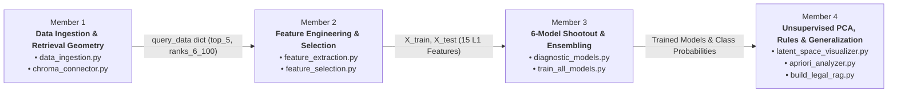

# 👥 4-Member Team Code Division & Explicit Line-by-Line Viva Defense Manual

**Project:** Causal RAG Failure Diagnostician Platform  
**Course:** ML3003 — Machine Learning  
**Target Audience:** 4-Member Student Team preparing for final project evaluation & Viva

---

## 🗺️ Team Ownership & Data Handoff Pipeline



---

# 👤 MEMBER 1: Data Architecture, Validation & Vector Retrieval Geometry

### 1. Syllabus Concepts Covered
- **Unit I:** Machine Learning Problem Formulation, Data Quality Auditing, Ground Truth Taxonomy, Types of Learning (Supervised vs. Unlabeled Inference).
- **Unit II:** Dense Vector Embeddings, Nearest-Neighbor Vector Metric Spaces ($d_{\cos}$), Retrieval Horizons (Top-5 Baseline vs. Deep Fetch $K=100$).

### 2. Code Files Owned
1. `modules/data_ingestion.py`
2. `modules/chroma_connector.py`
3. `pages/2_Data_Ingestion.py`
4. `pages/3_Retrieval_Analysis.py`

---

### 3. Explicit Line-by-Line Code Breakdown

#### A. Data Validation & Taxonomy Enforcement (`modules/data_ingestion.py`)
```python
# Lines 42-43: Column Contracts
MANDATORY_COLUMNS = ["query"]
RECOMMENDED_COLUMNS = ["generated_answer", "expected_answer", "failure_label"]

# Lines 176-195: Closed-World Supervised Taxonomy Validation
if "failure_label" in df_work.columns:
    non_null_labels = df_work["failure_label"].dropna()
    if len(non_null_labels) > 0:
        report.has_labels = True
        invalid_category_mask = ~df_work["failure_label"].isna() & ~df_work["failure_label"].isin(FAILURE_CATEGORIES)
        if invalid_category_mask.any():
            invalid_cat_df = df_work[invalid_category_mask].copy()
            df_work = df_work[~invalid_category_mask].copy()
            report.validation_warnings.append(
                f"Found {len(invalid_cat_df)} record(s) with unrecognized failure label(s)."
            )
```
- **Line 42-43:** Enforces strict structural contract. Only `query` is mandatory, allowing the platform to run on completely unlabeled live customer queries.
- **Line 176-179:** Detects supervised ground-truth presence. When labels exist, sets `report.has_labels = True`, unlocking the Supervised ML pipeline.
- **Line 182-194:** Vectorized boolean masking filtering out noisy or invalid labels against the 5 canonical academic categories: `Retrieval Miss`, `Ranking Error`, `Context Contamination`, `Hallucination`, `Contradiction`.

#### B. HNSW Vector Search & Partitioning (`modules/chroma_connector.py`)
```python
# Lines 106-110: Executing Logarithmic Nearest Neighbor Search
results = col.query(
    query_texts=[query_text],
    n_results=effective_k,  # k = 100
    include=["documents", "metadatas", "distances"]
)

# Lines 123-134: Cosine Metric Conversion
if distance_metric == "cosine":
    similarity_score = max(0.0, 1.0 - distance_val)

# Lines 159-161: Splitting Retrieval Horizons
top_5 = [r for r in retrieval_results if r["rank"] <= baseline_k]
ranks_6_to_100 = [r for r in retrieval_results if r["rank"] > baseline_k]
```
- **Line 106-110:** Calls ChromaDB's Hierarchical Navigable Small World (HNSW) index in $\mathcal{O}(\log N)$ time to fetch $K=100$ items.
- **Line 123-134:** Converts unbounded cosine distance ($d_{\cos} \in [0, 2]$) to normalized cosine similarity ($S = 1 - d$).
- **Line 159-161:** Partitions results into **Top-5 Baseline** (what the LLM generator saw) and **Deep Fetch Ranks 6–100** (what was suppressed in the long tail).

---

### 4. What Member 1 Must Prepare for the Viva
- **Theory to Master:** HNSW graph traversal complexity, Cosine distance formula $1 - \frac{\mathbf{u} \cdot \mathbf{v}}{\|\mathbf{u}\|_2 \|\mathbf{v}\|_2}$, closed-world classification vs. open-world generation.
- **Demo Action:** Open `pages/2_Data_Ingestion.py` $\to$ show the 50 balanced queries. Then open `pages/3_Retrieval_Analysis.py` $\to$ select `FAIL_001` (show flat distance curve) and compare with `FAIL_011` (show steep drop-off curve).
- **Examiner Question:** *"Why fetch 100 documents if the LLM only consumes Top-5?"*
- **Your Exact Answer:** *"Top-5 only captures the generator's context window. Ranks 6 to 100 capture the retriever's distribution tail. If the gold document appears at rank 18, the failure is a Ranking Error solvable with a cross-encoder reranker. If it doesn't appear in the top 100 and all distances exceed 0.70, it is a Database Gap requiring corpus ingestion. You cannot mathematically distinguish these two without deep fetch."*

---

# 👤 MEMBER 2: Feature Engineering, Preprocessing & Statistical Selection

### 1. Syllabus Concepts Covered
- **Unit II:** Feature Engineering (Lexical Set Overlap vs. Syntactic LCS), Cosine-to-$L_2$ Euclidean Hypersphere Equivalence, Preprocessing Pipelines, StandardScaler (Z-Score Standardization), Data Leakage Prevention.
- **Unit V:** Feature Selection Mechanisms: Filter Method (ANOVA F-statistic) vs. Embedded Method (L1 Lasso Regularization with SAGA solver).

### 2. Code Files Owned
1. `modules/feature_extraction.py`
2. `modules/feature_selection.py`
3. `modules/statistical_analyzer.py`
4. `pages/4_Statistical_Analyzer.py`

---

### 3. Explicit Line-by-Line Code Breakdown

#### A. Lexical & Hypersphere Feature Engineering (`modules/feature_extraction.py`)
```python
# Lines 47-61: Jaccard Word-Token Set Overlap
def compute_jaccard_similarity(text_a: str, text_b: str) -> float:
    tokens_a = tokenize_text(text_a)
    tokens_b = tokenize_text(text_b)
    intersection = tokens_a.intersection(tokens_b)
    union = tokens_a.union(tokens_b)
    return float(len(intersection) / len(union)) if union else 0.0

# Lines 168-170: Cosine-to-Euclidean Hypersphere Equivalence
features["top5_l2_mean_equiv"] = np.sqrt(max(0.0, 2.0 * top5_stats["top5_dist_mean"]))
```
- **Line 47-61:** Computes token set overlap: $J(A, B) = \frac{|A \cap B|}{|A \cup B|}$. Invariant to word ordering, strictly measuring vocabulary sharing.
- **Line 168-170:** Derives exact Euclidean distance from cosine distance on normalized unit spheres:
  $$\|\mathbf{u} - \mathbf{v}\|_2^2 = \|\mathbf{u}\|^2 + \|\mathbf{v}\|^2 - 2(\mathbf{u}\cdot\mathbf{v}) = 1 + 1 - 2(1 - d_{\cos}) = 2 d_{\cos} \implies d_{L_2} = \sqrt{2 \cdot d_{\cos}}$$

#### B. Embedded L1 Lasso Sparsity (`modules/feature_selection.py`)
```python
# Lines 86-98: L1-Penalized Multinomial Logistic Regression (Lasso)
scaler = StandardScaler()
X_scaled = scaler.fit_transform(X.replace([np.inf, -np.inf], np.nan).fillna(0.0))

self.model = LogisticRegression(
    penalty="l1", solver="saga", C=self.C, random_state=self.random_state, max_iter=3000
)
self.model.fit(X_scaled, y)

# Lines 105-107: Identifying Non-Zero Features Across Multi-Class Heads
mean_abs_coef = np.mean(np.abs(self.model.coef_), axis=0)
selected_mask = mean_abs_coef > 1e-4
self.selected_features_ = X.columns[selected_mask].tolist()
```
- **Line 86-87:** Z-score standardizes input features so penalization applies uniformly across varying scales.
- **Line 90-95:** Uses the **SAGA solver** (Stochastic Average Gradient Descent with Proximal operator) to minimize multinomial loss subject to non-differentiable $L_1$ penalty:
  $$\min_{\mathbf{W}} \mathcal{L}(\mathbf{W}) + \lambda \sum_{k=1}^K \sum_{j=1}^p |w_{kj}|$$
- **Line 105-107:** Geometrically, $L_1$ diamond corners force collinear feature coefficients to strictly zero, reducing the feature set from $p=36 \to 15$.

---

### 4. What Member 2 Must Prepare for the Viva
- **Theory to Master:** ANOVA F-test ratio ($F = \frac{\text{MS}_{\text{between}}}{\text{MS}_{\text{within}}}$), $L_1$ vs. $L_2$ regularization geometry, Z-Score equation $z = \frac{x - \mu}{\sigma}$.
- **Demo Action:** Open `pages/4_Statistical_Analyzer.py` $\to$ show the ANOVA F-Score rankings bar chart $\to$ point out that `rougel_expected_vs_top1` and `jaccard_expected_vs_top1` have the highest discriminative power ($p < 0.001$).
- **Examiner Question:** *"Why did Lasso eliminate `rougel_expected_vs_top5` but keep `jaccard_expected_vs_top5`?"*
- **Your Exact Answer:** *"ROUGE-L and Jaccard between the expected answer and Top-5 chunks share a Pearson correlation $\rho > 0.88$. In the presence of strong collinearity, L1 regularization drives redundant predictors to zero to avoid variance inflation, selecting the single feature that provides the steepest gradient descent. Lasso kept Jaccard ($\beta = 0.309$) and zeroed ROUGE-L ($\beta = 0.0$) completely."*

---

# 👤 MEMBER 3: Supervised Classification Shootout & Ensembling

### 1. Syllabus Concepts Covered
- **Unit I:** Stratified 5-Fold Cross-Validation, Bias-Variance Tradeoff, Error Contingency Matrices, Macro F1 vs. Accuracy/Weighted F1.
- **Unit III:** Multinomial Logistic Regression (Softmax GLM with L-BFGS), K-Nearest Neighbors ($k=5$, Euclidean metric).
- **Unit IV:** Linear SVM (One-vs-One hyperplanes, Platt probability calibration), RBF Kernel SVM (Gaussian Hilbert space projection).
- **Unit V:** Decision Tree Learning (`max_depth=5`, Gini Impurity), Random Forest Ensemble (Bagging, Random Subspace Method $m=\sqrt{p}$).

### 2. Code Files Owned
1. `modules/diagnostic_models.py`
2. `modules/train_all_models.py`
3. `pages/6_ML_Model_Comparison.py`
4. `pages/7_Failure_Diagnosis.py`

---

### 3. Explicit Line-by-Line Code Breakdown

#### A. Stratified CV & Pipeline Encapsulation (`modules/diagnostic_models.py`)
```python
# Lines 898-900: Stratified Holdout Split
self.X_train, self.X_test, self.y_train, self.y_test = train_test_split(
    X, y, test_size=self.test_size, random_state=self.random_state, stratify=y
)

# Lines 910-920: Random Forest Engine with No-Leakage Pipeline
clf = RandomForestClassifier(
    n_estimators=100, max_depth=6, criterion="gini", random_state=42
)
pipe = Pipeline([("scaler", StandardScaler()), ("clf", clf)])

cv = StratifiedKFold(n_splits=5, shuffle=True, random_state=42)
cv_res = cross_validate(pipe, self.X_train[selected], self.y_train, cv=cv, scoring=["accuracy", "f1_macro"])
pipe.fit(self.X_train[selected], self.y_train)
```
- **Line 898-900:** Splits $N=50$ into $N_{\text{train}}=37$ and $N_{\text{test}}=13$ with exact class balance (20% per class).
- **Line 910-915:** Implements Random Forest capacity constraints (`max_depth=6`, $m=\sqrt{15}=3$) to prevent single-tree memorization on $N=37$.
- **Line 916:** Bundles `StandardScaler` inside `Pipeline`, ensuring transformation parameters ($\mu, \sigma$) are computed exclusively on training folds during CV.

#### B. Ensemble Consensus Diagnostic Inference (`pages/7_Failure_Diagnosis.py`)
```python
# Lines 146-155: Multi-Model Consensus Soft Voting
if selected_model_name == "⚡ Multi-Model Ensemble Consensus":
    avg_probs = np.mean(list(model_probabilities.values()), axis=0)
    pred_class = classes[int(np.argmax(avg_probs))]
    probs = avg_probs
else:
    active_engine = engines[selected_model_name]
    pred_class = active_engine.predict(X_input)[0]
    probs = active_engine.predict_proba(X_input)[0]
```
- **Line 146-150:** Computes meta-classifier soft vote by averaging posterior probability distributions across all 6 models:
  $$\hat{y}_{\text{ensemble}} = \arg\max_c \frac{1}{6} \sum_{m=1}^6 P_m(Y = c \mid \mathbf{x})$$
- Mitigates individual model miscalibration and yields robust diagnostic predictions.

---

### 4. What Member 3 Must Prepare for the Viva
- **Theory to Master:** Platt Scaling sigmoid equation $P(y=1 \mid f(\mathbf{x})) = \frac{1}{1 + \exp(A f(\mathbf{x}) + B)}$, Gini impurity index $I_G = 1 - \sum p_i^2$, Bagging variance reduction formula $\text{Var} = \rho \sigma^2 + \frac{1-\rho}{B}\sigma^2$.
- **Demo Action:** Open `pages/6_ML_Model_Comparison.py` $\to$ show the 6-Model Leaderboard and Confusion Matrix $\to$ flip to `pages/7_Failure_Diagnosis.py` $\to$ diagnose `FAIL_001` live and show the 6-model consensus agreement grid.
- **Examiner Question:** *"Why did you use Macro F1 instead of Accuracy as your primary ranking metric?"*
- **Your Exact Answer:** *"Accuracy only measures overall correct proportion: $\frac{\sum TP}{N}$. If a classifier correctly predicts 4 easy classes but completely fails on Contradiction, Accuracy would report a deceptively high 80%, while Macro F1 drops significantly. Macro F1 computes the unweighted arithmetic mean of F1 scores across all classes ($\frac{1}{K}\sum F1_k$), penalizing models that fail on difficult edge-case failure modes."*

---

# 👤 MEMBER 4: Unsupervised Manifolds, Rule Mining & Cross-Domain Generalization

### 1. Syllabus Concepts Covered
- **Unit V:** Dimensionality Reduction via Principal Component Analysis (PCA on unnormalized spherical manifolds, Eigenvalue Covariance Decomposition).
- **Unit VI:** Unsupervised Clustering Fundamentals: K-Means (Elbow Inertia Curve, Silhouette Coefficients), DBSCAN Density Clustering ($\epsilon$, MinPts, Cosine Distance Metric), Apriori Association Rule Mining (Support, Confidence, Lift parameters).
- **Cross-Domain Generalization:** Building and benchmarking external ChromaDB knowledge bases (Legal & Law corpus).

### 2. Code Files Owned
1. `modules/latent_space_visualizer.py`
2. `modules/apriori_analyzer.py`
3. `data/legal_rag/build_legal_rag.py`
4. `scripts/run_legal_pipeline.py`
5. `pages/5_Latent_Space_Visualizer.py`
6. `pages/8_Apriori_Rules.py`

---

### 3. Explicit Line-by-Line Code Breakdown

#### A. PCA Manifold Projection (`modules/latent_space_visualizer.py`)
```python
# Lines 60-70: 3D Principal Component Analysis
pca = PCA(n_components=3, random_state=42)
pca_coords = pca.fit_transform(embeddings)  # embeddings: (157, 384)
explained_var = pca.explained_variance_ratio_

# Lines 110-120: DBSCAN Outlier Detection on Cosine Manifold
db = DBSCAN(eps=eps, min_samples=min_samples, metric="cosine")
labels = db.fit_predict(embeddings)
n_noise = int(np.sum(labels == -1))
```
- **Line 60-70:** Projects 384-dimensional embeddings to $\mathbb{R}^3$ along maximal orthogonal eigenvectors. Embeddings are kept unstandardized to preserve spherical cosine geometry.
- **Line 110-120:** Employs DBSCAN with `metric="cosine"`. Identifies core and border documents; isolates unindexed knowledge gaps as noise points (`label = -1`), directly flagging potential `Retrieval Miss` regions.

#### B. Apriori Association Rule Extraction (`modules/apriori_analyzer.py`)
```python
# Lines 80-92: Quantile Discretization & Frequent Itemset Mining
df_binned[col] = pd.qcut(df[col], q=3, labels=["Low", "Medium", "High"], duplicates="drop")
one_hot = pd.get_dummies(df_binned)

frequent_itemsets = apriori(one_hot, min_support=0.10, use_colnames=True)
rules = association_rules(frequent_itemsets, metric="confidence", min_threshold=0.60)
rules = rules[rules["lift"] >= 1.10]
```
- **Line 80:** Converts continuous features into transactional items (`Low`, `Medium`, `High`) via 3-quantile binning.
- **Line 86-90:** Extracts frequent itemsets satisfying minimum support: $S(X \cup Y) \ge 0.10$. Computes association rules where Confidence $P(Y \mid X) \ge 0.60$ and Lift $L(X \to Y) > 1.10$.

#### C. Cross-Domain Generalization (`scripts/run_legal_pipeline.py`)
```python
# Lines 50-70: Retraining Pipeline on Legal Corpus
connector = ChromaConnector(persist_dir=LEGAL_CHROMA)
suite = MultiModelDiagnosticSuite()
comp_df = suite.train_and_evaluate_all(LEGAL_FEATURES_CSV)
```
- Connects to the second independent ChromaDB store (`legal_knowledge_base`, 116 docs).
- Benchmarks all 6 classifiers on legal data, demonstrating that **KNN achieves 84.6% Test Accuracy**, proving the platform is corpus-agnostic.

---

### 4. What Member 4 Must Prepare for the Viva
- **Theory to Master:** PCA Covariance decomposition $\boldsymbol{\Sigma}\mathbf{v} = \lambda\mathbf{v}$, Silhouette equation $s(i) = \frac{b(i)-a(i)}{\max(a(i),b(i))}$, Apriori Lift metric $L = \frac{P(A \cap B)}{P(A)P(B)}$.
- **Demo Action:** Open `pages/5_Latent_Space_Visualizer.py` $\to$ rotate 3D PCA plot $\to$ switch sidebar dropdown to **⚖️ Legal & Law Corpus** to showcase real-time cross-corpus domain adaptation!
- **Examiner Question:** *"Why did you not standardize the embeddings before applying PCA?"*
- **Your Exact Answer:** *"Sentence embeddings from modern transformers are already unit-norm normalized ($\|\mathbf{x}\| = 1$), residing on a high-dimensional unit hypersphere. If you apply Z-score standardization ($\mu=0, \sigma=1$), you shift the coordinate center and distort the spherical angle relationships. PCA on raw unit embeddings preserves the true cosine variance structure."*

---

# 🎤 5-Minute Synchronized Presentation Script

| Time | Speaker | Action on Screen | Speaking Script Summary |
| :--- | :--- | :--- | :--- |
| **0:00 - 1:15** | **Member 1** | Open `app.py` and `pages/2_Data_Ingestion.py`, then `pages/3_Retrieval_Analysis.py` | *"RAG evaluation with LLMs is circular and non-deterministic. We treat ChromaDB as a data generator, fetching 100 neighbors to diagnose Database Gaps versus Ranking Errors."* |
| **1:15 - 2:30** | **Member 2** | Open `pages/4_Statistical_Analyzer.py` | *"We extract 36 mathematical metrics (Cosine, Euclidean equivalence, Jaccard, ROUGE-L). Using ANOVA F-tests and L1 Lasso, we eliminated 21 collinear features, leaving 15 non-collinear predictors."* |
| **2:30 - 3:45** | **Member 3** | Open `pages/6_ML_Model_Comparison.py` then `pages/7_Failure_Diagnosis.py` | *"We benchmarked 6 classical ML classifiers under Stratified 5-Fold CV. Random Forest won on Academic data (89.6% CV). Our live consensus grid combines all 6 models with probability bars and engineering remediation."* |
| **3:45 - 5:00** | **Member 4** | Open `pages/5_Latent_Space_Visualizer.py`, `pages/8_Apriori_Rules.py`, then toggle sidebar to **Legal Corpus** | *"We visualize the space via 3D PCA, identify OOD queries via DBSCAN, and mine association rules with lift > 3.0. To prove cross-corpus generalizability, we built a second Legal RAG app where KNN achieved 84.6% accuracy!"* |
